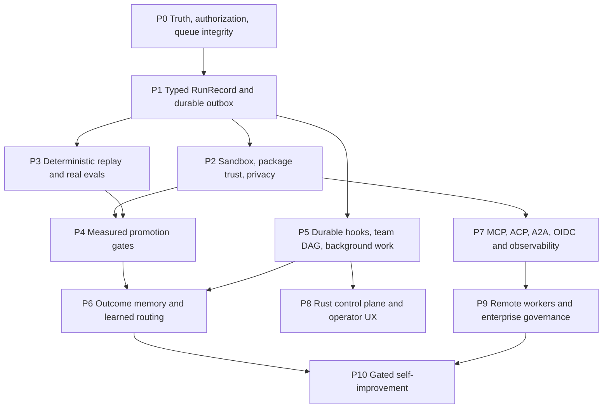

# Hermes Agent Ultra Execution Roadmap (2026-07-16)

Status: active execution program  
Fork baseline: `c002f8c4` (`main`, PR #720 merge)  
Fetched NousResearch upstream baseline: `42bd4368` (verified 2026-07-16)
Release baseline: `v0.22.0`

## Objective

Make Hermes Agent Ultra the most trustworthy and desirable Rust-first agent harness: production-complete before feature-broad, deterministic under failure, interoperable with the leading agent protocols, locally useful by default, and measurably better than its prior release and fixed external holdouts.

This roadmap supersedes Issue #702's closed-status interpretation and the prior `0 critical gaps` roadmap prose. Issue #702 remains a useful product taxonomy, but its catalog/checklist evidence is not proof that the corresponding capability works end to end.

## Completion Contract

A capability is complete only when all of the following exist:

1. A production callsite used by a real CLI, gateway, API, ACP, or released-binary path.
2. A real dispatch/consumer branch, not a status object, catalog row, generated fixture, or prose claim.
3. A failure-path test covering the material error, cancellation, or partial-write behavior.
4. A smoke exercise through the public surface.
5. A versioned eval-ledger record containing the baseline, metric, holdout, cost, latency, tool calls, failures, artifact digest, and reproduction command.
6. A rollback path that restores the last signed release without losing durable state.

Generated fixtures, issue labels, command catalogs, `status: implemented`, self-reported JSON, and keyword/prose scoring cannot satisfy this contract.

## Evidence Baseline

### Repository and upstream

- The fork and upstream histories are divergent and currently have no trustworthy merge-base in the available history. Raw ahead/behind counts are therefore not parity evidence.
- The old upstream queue and readiness artifacts reuse stale dispositions, accept missing source facts, and can pass without a fresh source ledger. They are quarantined until Phase P0 regenerates them fail closed.
- The only valuable unmatched local branch work found in the branch inventory is the mixed commit `c3c3ade`; its query-slash and old session renderer are superseded, while corrected config-output redaction and the bounded session list option are recoverable.
- Eleven other candidate commits are tree-equivalent to squash merges already on `main`; they must not be replayed.
- Kimi K3 requires paid/top-up access in the official paths inspected. Per operator direction, no paid Kimi probe is part of this program. Catalog/profile parity may proceed without claiming runtime inference proof.

## Operating Constraints

- Treat every dirty file, local branch, remote feature branch, and isolated worktree as possible user upgrade work. Verify patch-ID, whole-tree/content equivalence, production behavior, and newer-main conflicts before recovery; never reset or replay a branch from its name alone.
- Prove a production gap and locate the authoritative existing component before implementing code. Extend that component; do not build a second facade or source of truth from first impressions.
- Parallelize independent audits and work packets with specialized agents, but keep each writer isolated by file/worktree contract and review intentional deltas against the live dirty baseline before integration.
- Use only operator-provided/local model access and no paid inference APIs. Kimi K3 is deferred until a free/operator-approved route exists and its request profile is corrected.
- Use ContextLattice compact scoped retrieval and checkpoints plus repo-local `handoffs/` for every packet. Each handoff records the baseline SHA, pre-edit provenance/gap verdict, files touched, checks, and remaining risks.
- Preserve workstation headroom: no broad process stops, no overlapping heavy Rust builds, `CARGO_BUILD_JOBS=4`, external `CARGO_TARGET_DIR`, and focused checks before full gates.
- Use installed task-specific skills when they add a verified workflow. Search results alone do not justify installing low-trust skills.

### Issue #702 production-completeness audit

| # | Capability family | Current verdict | Existing implementation to reuse | Missing production contract |
| ---: | --- | --- | --- | --- |
| 1 | Curated SOTA skills | Partial | skill taps, SkillGuard, skills CLI | installable/indexed quality metadata, provenance, runtime recommendations |
| 2 | OIDC cockpit | Partial | dashboard OIDC and relay work | standards-level lifecycle, mock server, token failure/revocation tests |
| 3 | Runtime proof cockpit | Partial | `/harness`, `harness_cockpit`, proof readers | authoritative evidence derived from runtime records |
| 4 | Domain-model generator | Facade | catalog/action row | real producer, persisted artifact, consumer, failure path |
| 5 | Architecture reporter | Facade | catalog/action row | real repository analysis and versioned report |
| 6 | SOTA replay | Partial | ReplayRecorder and replay controls | exact production replay, branch replay, drift detection |
| 7 | Session replay recorder | Partial | hash-chained JSONL recorder | crash-safe ordered ledger, complete lineage/artifact digests |
| 8 | Architecture-first auto scanner | Partial | runtime metadata/index surfaces | installation quality, behavioral verification, versioned metadata |
| 9 | Intelligent skill router | Partial | SmartModelRouter, skill metadata | learned routing with fixed holdout, cost/latency constraints, rollback |
| 10 | Objective-based harnessing | Partial | objective contract/DAG/status | durable execution, policy enforcement, resumable lifecycle |
| 11 | Chaos evaluations | Partial | real adapter chaos harness plus policy simulation | retained runtime ledger and broader production failure corpus |
| 12 | Onboarding commands | Partial | CLI command surfaces | one-command install, health diagnosis, repair, upgrade and rollback |
| 13 | Shared team memory | Partial | memory and ContextLattice integrations | tenant/privacy semantics, concurrent writes, durable checkpoints |
| 14 | Spawn-task delegation | Partial | SubAgentOrchestrator, background delegation | governed team DAG, budgets, locks, cancellation and recovery |
| 15 | Grill-me skills | Facade | static catalog row | executable adversarial evaluator and promotion gate |

Corrected aggregate: `0 complete / 12 partial / 3 facade-only` at the baseline above.

P0 truth cutover: `harness_cockpit` serializes that aggregate from typed per-item maturity, exposes observed evidence separately from the missing production/smoke/evaluation contract, and derives `production_complete` from the same summary for structured and text output. Skills are recommendations, proof is diagnostic, and chaos entries are non-executable checklists until their gates above are satisfied. Verification: `cargo test -p hermes-tools harness_cockpit --lib` passed all six focused regressions.

## Authoritative Components and No-Duplicate Rule

| Concern | Authoritative component to extend | Do not create |
| --- | --- | --- |
| Session capture | `ReplayRecorder` in `hermes-agent` | another JSONL recorder |
| Benchmark results | `hermes_eval::RunRecord` and `JsonReporter` | a third type also named `RunRecord` |
| Live API run state | gateway API-server run store | an eval substitute or durable session ledger |
| Tool policy | `ToolPolicyEngine` and `tool_policy_simulate` | a parallel allow/deny engine |
| Skill trust | `SkillGuard`, content hash, runtime skill tier | a second heuristic scanner |
| Agent delegation | `SubAgentOrchestrator` | a catalog-only "team" runtime |
| Hooks | `PluginManager` and gateway hook registry | prose-only hook definitions |
| Memory | existing memory manager plus ContextLattice adapter | unscoped duplicate vector stores |
| Upstream truth | new fail-closed source ledger and queue generator | ahead/behind or issue-state inference |
| Product control | Rust CLI/gateway/control-plane surfaces | a new Electron dependency |

`harness_cockpit` remains an index over subsystem-owned evidence. It must not become a second implementation of telemetry, replay, objectives, authorization, skills, or evaluation.

## Dependency Graph



## P0 — Truth, Authorization, and Queue Integrity

Priority: release blocker. Nothing may be promoted while P0 evidence is untrustworthy or queued work can be silently lost.

### P0-A Fail-closed parity source ledger

Work:

- Record canonical remote URLs, exact fork/upstream SHAs, fetch time and freshness, shallow/full state, merge-base result, generator version, and the complete classified range.
- Bind local evidence to separate index/worktree/untracked cleanliness plus a deterministic non-mutating tree-state digest; commit SHA alone cannot authorize evidence from a dirty tree.
- Replace git-cherry-only and prefix-SHA normalization with exact SHA plus patch-id/tree-content equivalence.
- Reject missing refs, malformed overrides, null merge-base, incomplete range fetches, ambiguous mappings, stale source SHAs, reused prior dispositions without proof, dirty release sources, and unowned divergence.
- Make readiness fail when a required source or metric is absent. Regenerate queue, proof, shared-diff, and public readiness artifacts from fresh refs.

Gate:

- Failure fixtures for every missing/stale/malformed source state return nonzero.
- A rebased equivalent change classifies as represented only with exact provenance.
- An unclassified delta forces readiness failure.

- Staged, unstaged, and untracked mutations change the source digest and force authoritative release failure.

### P0-B Scoped gateway authorization

Work:

- Separate pairing/DM authorization from configured group and slash-command authorization.
- Bind grants to platform, chat scope, user, grant origin, expiry, and allowed operation.
- Resolve grants through code-addressed pending bindings and persist versioned pending/grant/revocation state before mutating memory.
- Store owner-only state at the canonical Hermes state root with atomic replacement, file and parent-directory durability, rollback on post-replace failure, and fail-closed unsupported platforms.
- Add `is_admin_for_platform`; platform admins can grant only on their own platform.
- Preserve explicit Discord bot bypass only after channel and policy gates.
- Ensure colliding user IDs on another platform never inherit a grant.

Gate:

- DM approval permits the DM but not group, slash, or cross-platform access.
- Configured platform admins can grant locally; non-admin and cross-platform attempts fail.
- Restart, expiry, write/replace/directory-sync failure, corrupt schema, insecure permissions, and revoke tests preserve exact authorization state and never emit false success.

### P0-C Transactional busy-session queue

Work:

- Atomically claim an idle session or enqueue.
- Queue a private envelope containing the message, verified sender provenance, and server-only ingress-validation state.
- Deduplicate once at ingress; internal drain must not self-deduplicate.
- Use generation/lease ownership so failure, delivery error, task abort, interrupt, cancellation, or `/reset` cannot orphan the active slot.
- Fence late completion after reset. Preserve original errors while guaranteeing eligible queued continuation.
- Fix the 32-item drain boundary with budget-before-pop or an owned continuation; never pop an item without a consumer.
- Wire the sender-aware route into real adapter ingress rather than tests only.

Gate:

- Concurrent first messages serialize at max concurrency one and preserve FIFO.
- Mixed human/bot senders retain identity.
- Duplicate ingress is suppressed while a drained item runs once.
- Handler error, delivery error, abort, interrupt, and reset do not silently lose or replay work.
- At least 33 unique IDs drain exactly once with `pending = 0`.

### P0-D Recover verified local upgrades

Work:

- Port field-aware, recursive config redaction to standalone and slash config output.
- Redact typed and arbitrary nested tokens, API keys, webhook URLs, adapter encryption keys, URL userinfo/query credentials, and free-form Docker env assignments.
- Never echo a secret value from `config set`; keep nonsecret lookalikes such as `max_tokens`, `api_key_env`, and OAuth token endpoint URLs visible.
- Make secret masking UTF-8 safe.
- Add `sessions list --limit` to the current canonical/artifact renderer without restoring the stale candidate renderer.

Gate:

- Public config display/set smoke paths contain sentinels only as `[REDACTED]`.
- Multibyte secrets cannot panic.
- Session row limits apply after the current canonical sort and report omitted rows.

### P0-E Native Discord Gateway ingress

Work:

- Run one owned Discord Gateway v10 socket with HELLO, scheduled and server-requested heartbeat handling, ACK liveness, IDENTIFY/RESUME, close-code semantics, bounded reconnect, proxy configuration, and deterministic stop.
- Carry server-verified human/bot/webhook identity, guild, role IDs, channel, and real thread-parent context into the server-only ingress envelope.
- Reuse `DiscordInteractionAuthPolicy`/`DiscordInteractionSubject` for guild-scoped user-or-role authorization and carry the authorization result through `route_validated_ingress`; do not add a second role matcher or bypass channel/group gates.
- Default Discord group authorization to fail closed when no allowlist exists unless the operator explicitly enables open/allow-all. `require_mention` defaults to true.
- Keep heartbeat/socket progress independent from slow agent turns. Retain bounded accepted events locally or durably before sequence advance, and treat a closed/missing consumer as terminal unhealthy rather than reconnecting forever.
- Resolve actual Discord thread context and mark production participation so unmentioned follow-ups are allowed only after Hermes has participated.
- Pass trusted DM/group and thread scope into the authoritative session API. Do not infer session type from chat-ID formatting; key sibling threads separately while keeping parent-channel authorization and reply routing.

Gate:

- Mock Gateway protocol covers IDENTIFY intents, READY self filtering, RESUME and non-resumable INVALID_SESSION, close codes, proxy handling, server heartbeat requests, zombie reconnect, and deterministic stop.
- Saturated routing followed by non-resumable session invalidation delivers every accepted message exactly once without sequence skip or heartbeat stall; closed consumer terminates.
- No-policy, wrong-channel, and wrong-role users are denied; configured channel, user, or verified guild role is accepted according to the existing OR policy; ignored channel always wins; explicit open mode is the only unrestricted path.
- Real MESSAGE_CREATE fixtures prove DM, guild, webhook/bot, and thread routing plus participation behavior.
- Two sibling threads under one parent have independent history, busy/reset state, and session identity; parent channel authorization remains shared.
- Focused mock checks pass before integration; a credentialed smoke against a controlled Discord application is required before release promotion.

## P1 — Typed SessionRunEvent and Durable Event Outbox

### P1-A SessionRunEvent v1 and transactional commit

Status: corrected, pending independent re-review. P1 implementation cannot start until P0 closure.

- Before the first ledger integration, define closed typed `ExecutionMode` (`manual`, `reviewed`, `autonomous_local`, `ci`, `remote_worker`) and one resolver with precedence defaults → profile → config file → environment → CLI. Ledger APIs accept only its resolved value; unknown/conflicting values fail closed, and only resolved `manual` may return an explicit typed degraded result. Objective labels are not modes.
- Promote `ReplayRecorder` semantics into one typed SQLite/WAL ledger, keeping benchmark `hermes_eval::RunRecord` and gateway live run state distinct. JSONL is a derived per-run export, never an authoritative or independent writer.
- Keep exactly six outcomes—success, failure, timeout, cancellation, blocked, dead-lettered—and closed typed terminal reasons. `unknown_non_resumable` is an effect-reconciliation state, not a seventh outcome.
- Use one `LedgerConnectionFactory` for migration, writers, workers, and export reads; verify WAL and apply `synchronous=FULL`, foreign keys, and bounded busy timeout on every connection. Its one `BEGIN IMMEDIATE` v0→v1 transaction creates/validates all tables and indexes, writes schema version plus `ledger_primary`, then commits cutover. Unknown/newer or mismatched markers refuse startup; downgrade is offline verified backup/export restore, never a flag.
- `AppendEvent` carries a stable append key and typed effect intents, not destinations or a manifest. Before sealing, it computes a versioned domain-separated HMAC/keyed fingerprint under a ledger-identity key distinct from artifact encryption over credential-free private canonical JCS plus canonical public identity; reservation persists only public identity and fingerprint/version/key ID, never private JCS or raw digest. `reserve_append` returns a matching receipt/one lease only for the exact tuple; same key/public with a different private fingerprint is a pre-seal conflict. Unavailable identity key fails closed with no unkeyed/public-only fallback. The closed versioned dispatch policy derives, canonicalizes, persists, and validates the full required manifest/outbox set only in `commit_reserved_append`; matching contenders reuse the published verified reference/receipt rather than resealing.
- Hash RFC 8785/JCS-v1 immutable envelopes and canonical manifests; include full lineage, provenance, typed outcome/reason, `previous_event_hash`, and canonicalization ID/version, excluding only the event-hash field.
- Wrap `run` and `run_stream` so one transaction creates run/start, every inner return becomes exhaustive `RunExit`, and a finalizer appends its exit under the same run-header reconciliation lock used by delivery completion. Zero/all-ACK required rows finalize the candidate on exit; required exhaustion latches typed `dead_lettered` even before exit and cannot be overwritten. Run lease/heartbeat reconciliation safely resumes or emits typed `failure/process_death`; finalizer failure overrides normal success in fail-closed modes.

Gate:

- Exhaustively test mode precedence/conflicts and mandatory-mode ledger failure before the first append.
- Crash-inject every migration DDL/validation/marker boundary and prove all-or-nothing schema/marker visibility, enforced connection settings, no legacy writer, and explicit v0/raw-digest treatment for legacy JSONL.
- Prove concurrent semantic append identity: equal public/private inputs converge on one reservation/seal/receipt; same key/public with changed private JCS yields typed pre-seal conflict; identity-key unavailability fails closed; published artifacts are reused; no partial caller manifest can commit. SQL-scan ledger/reservation/outbox/artifact columns for a private sentinel and its raw private digest and prove both absent.
- Exercise zero-required, already-ACKed, last-ACK, and early-dead-letter races with every normal/early/streaming exit plus stale-heartbeat restart; each has one start/exit record, correct final outcome precedence, and no indefinitely open or pending-stranded run.

### P1-B Outbox delivery, protected artifacts, real alpha, and complete exports

- Before `BEGIN IMMEDIATE`, run a versioned fallible redactor, retain only an allowlisted projection in SQLite/outbox, derive the required ledger-keyed private fingerprint, JCS-canonicalize and encrypt private replay bytes, then write, file-`fsync`, digest-check, rename, and directory-`fsync` a sealed CAS artifact. Only the durable digest reference may enter the event/manifest/outbox transaction. Identity-key unavailability fails closed; only unavailable artifact-sealing key/store after successful fingerprinting may force safe public-only `sanitized_no_seal`/`exact_replay=false`; a sealing write/integrity failure aborts without an artifact reference; pre-commit sealed orphans are GC-able.

- Exact replay reads verify CAS digest, retention state, authorized non-revoked key, AEAD authentication, and plaintext JCS-v1 before exposure. Missing/corrupt/revoked/deleted artifacts atomically become audited unavailable with `exact_replay=false`, never public-projection fallback; retention first tombstones, then destroys/revokes or unlinks, and recovery remains unavailable.
- Claims atomically select ready/expired work, increment attempts and lease generation, and assign a fresh token/expiry. ACK/NACK/completion CAS row plus token; every registered outbox handler must accept the stable idempotency key and return a durable downstream receipt before ACK. Invalid/missing routes and decode failures use closed typed errors and deterministic dead-letter at exhaustion; non-dedupe handlers cannot register or be claimed.
- `complete_delivery` atomically persists receipt/error, an internal delivery-result event with an empty derived manifest, the outbox transition, and the run header; it shares the run-header reconciler with `finalize_run_exit`. Required pending work holds only while unresolved; zero/all-ACK rows finalize the recorded candidate, while required exhaustion latches typed `dead_lettered` even before `RunExit`.
- Commit typed intent before every hook, tool, model, or callback effect. Resumable intents get required outbox rows and close through `complete_delivery`. A non-dedupe effect is blocked or uses only a separate policy-allowlisted `NonResumableEffectExecutor`: it precommits an empty-manifest one-shot intent, CASes `armed → executing`, is neither registered nor claimable by the outbox, never retries, and recovers as operator-visible `unknown_non_resumable`/`failure/effect_non_resumable_unknown`.
- P1 chooses real alpha dispatch: `/mission enqueue` creates typed `AlphaRuntimeV1` work; `/mission replay` claims that durable intent through an exhaustive registered production router and receipt. `loop_queue` status changes cannot claim replay success.
- `export_run(run_id)` atomically replaces a full per-run export with immutable envelopes, canonical manifests, sealed references, compatibility aliases, source watermark, total/range, and `complete=true`; session readers explicitly select latest/all. All named replay/proof consumers use one shared JCS-v1 verifier and reject bounded tails, incomplete files, stale watermarks, or link-only/nonempty evidence. `HERMES_REPLAY_ENABLED` toggles export only, never ledger behavior.

Gate:

- Inject redaction, identity-key/HMAC, semantic-reservation, artifact key/store, write, each `fsync`, digest, rename, publication, append, claim, completion, exact-read/revocation/retirement, finalizer, and export crash boundaries; prove artifact-before-reference, one live artifact per semantic append, durable unavailable audit/tombstone, no private sentinel/raw private digest in SQL, no event/outbox divergence, no unowned effect, and no accepted partial export.
- Kill after a resumable effect/before completion, reclaim the lease, and prove one downstream durable receipt; race stale-token completion, `RunExit`, last ACK, and early dead-letter, and prove no state overwrite or pending strand.
- Exercise a one-shot non-resumable claim/effect/response crash, attempted outbox routing, required delivery exhaustion, missing/invalid alpha routes, and process restart; prove typed dead-letter or explicit unknown/non-resumable failure, never retry or status-only success.
- Export multiple runs, truncate/tamper data, and route every named consumer through the shared verifier; prove full run selection and rejection before replay, summary, integrity, or UI success.

### P1-C Typed CLI and runtime modes

- Extend the P1-A `ExecutionMode` model with typed `DiagnosticLevel` (`normal`, `verbose`, `debug`), generated help/schema, and typed configuration fields; reuse the P1-A resolver rather than creating a second mode path.
- Preserve the resolver's source/provenance and fail-closed behavior across all CLI/gateway/runtime entrypoints. No environment-only, objective-label, or diagnostic-level fallback may downgrade a `reviewed`, `autonomous_local`, `ci`, or `remote_worker` execution.
- Remove bespoke OIDC behavior in favor of a maintained standards crate where it reduces risk; cover discovery, PKCE/state/nonce, redirects, refresh, expiry, revocation, clock skew, provider errors, cookie/session lifecycle, and key rotation.

Gate:

- Run the exhaustive P1-A precedence/conflict and degraded-result matrix through generated help/schema and every runtime entrypoint; prove only resolved manual can degrade.
- Run protocol-level OIDC mock integration with successful and failed flows.

## P2 — Enforced Sandbox, Package Trust, and Privacy

### P2-A Local execution containment

- Extend the existing ToolPolicyEngine to `code_execution`; it currently protects command-tool names but not LocalCodeExecutionBackend.
- Default autonomous execution to a real filesystem/process/network jail on supported OSes.
- Enforce resource limits, network egress policy, process-tree containment, child-process rules, and output limits.
- Failure to initialize the sandbox demotes execution to manual; no silent unsandboxed fallback under an autonomous mode.

Gate:

- sandbox escape, symlink, child-process, secret-exfiltration, absolute-write and network-negative suites pass.

### P2-B Signed skills/plugins and supply-chain integrity

- Keep SkillGuard; add package digest, publisher identity, source, scan verdict and compatibility metadata at install.
- Refuse hash mismatch at load. Add signature verification and revocation/quarantine for skills/plugins.
- Scope policy, files, network, credentials and lifecycle by package identity.
- Delete or quarantine unverifiable/incompatible packages; no execution-only warning path.

Gate:

- tamper, unsigned, revoked, overprivileged and incompatible package tests fail closed.

### P2-C Unified privacy policy

- One privacy/forget/export policy consumed by replay, memory, gateway, sessions and telemetry.
- Tenant/team/user scope, retention, audit access and deletion semantics.
- Verify metadata is not re-identifiable; all stores and indexes reflect deletion.
- Keep credentials environment- or broker-backed; a new vault is a separate product decision, not an implicit feature.
- Retain credential source/type and authorization decision only. If equality evidence is indispensable, use a domain-separated keyed MAC whose key is separate from replay encryption and never persisted in the artifact; never store a raw hash of a bearer credential.

Gate:

- cross-store erasure and non-retrieval test with durable audit evidence; decrypt/export tests prove credential sentinels cannot be recovered.

## P3 — Deterministic Replay, Proof, and Real Evaluations

- Replay exact recorded production events and artifacts without calling providers only when the protected canonical payload is available and authorized; sanitized replay is explicitly labeled and cannot satisfy the exact-replay gate.
- Support branch replay from a checkpoint with lineage-complete new branches.
- Compare commit, config, model, provider, skill and policy changes through drift bisection.
- Replace prose/keyword outcome evaluators in promotion paths with typed task-specific evaluators.
- Build fixed public and private holdouts; seed and version all fixtures.
- Keep `hermes_eval::RunRecord` authoritative for benchmark results and bridge session evidence explicitly rather than renaming types.

Gate:

- authorized exact replay matches canonical transcript/event/artifact digests; sanitized replay matches its separate redacted-projection digests and is never promoted as exact.
- every chaos scenario proves both failure detection and recovery behavior.
- every eval artifact contains baseline, holdout, cost, latency, tool calls, failures and reproduction command.

## P4 — Measured Promotion and Release Gates

- One candidate must beat the frozen incumbent on utility/cost/latency/risk or remain unpromoted.
- Advertised capabilities require a production callsite, failure test and smoke result.
- Add canary rollout, drift detection, automatic rollback and a one-command signed-release rollback drill.
- Fixed-holdout lower confidence bounds must improve; in-sample wins never promote.
- Track p50/p95 latency, tokens, model calls, tool calls, success, retries, cost and failure taxonomy.

Gate:

- 24-hour soak with zero unaccounted durable events.
- rollback restores the prior signed release within five minutes without state loss.
- no release proof can pass on missing metrics.

## P5 — Durable Hooks, Governed Team DAG, and Background Automation

### Hooks

- First-class pre/post tool, model, approval, session, task, stop, notification and failure hooks.
- Hooks are idempotent, policy-scoped, auditable and delivered through the outbox.
- No third-party hook runs before P2 package trust and sandboxing.

### Team DAG

- Extend SubAgentOrchestrator with typed dependencies, isolated worktrees/sandboxes, file/resource locks, token/cost/time budgets, checkpoints, human approval gates, retries, cancellation and dead-letter policy.
- A durable merge protocol prevents overlapping workers from silently overwriting work.
- Existing ObjectiveDag is a plan until it dispatches through this runtime.

### Background work

- Durable jobs, scheduled automations and review/fix workflows.
- Pause/resume/cancel/retry from a checkpoint.
- Every run remains inspectable after restart.

Gate:

- supervisor restart resumes the graph without duplicate writes.
- conflicting workers cannot both merge without explicit reconciliation.

## P6 — Outcome Memory and Learned Routing

- Memory classes: scratch, recent, semantic, procedural, team and auditable decision history.
- Every record carries provenance, freshness, confidence, scope, retention and retirement semantics.
- Promote only useful verified outcomes; failed or stale context is demoted or retired.
- Learn routing over model/provider/skill/tool/agent topology with utility/cost/latency/risk.
- Router failure or low confidence returns to the signed incumbent policy.
- Candidate skill synthesis may mine successful replay clusters, but promotion remains gated.

Gate:

- fixed memory holdout measures retrieval precision/recall and downstream task effect.
- lower cost or latency must not violate the two-point quality non-inferiority bound.

## P7 — Interoperability and Observability

- MCP conformance for negotiated features only.
- ACP conformance for session lifecycle, prompt/update streams, tool calls, plans, terminal access, cancellation, authentication and capability negotiation.
- A2A remains disabled or capability-minimal until a named external runtime consumes it.
- Standards-level OIDC/OpenID Connect lifecycle from P1.
- OpenTelemetry-compatible traces correlate with Session RunRecord v1.
- JSON-RPC/protocol fixtures are bidirectional and include cancellation/reconnect.

Gate:

- real external MCP and ACP clients complete end-to-end sessions.
- unsupported protocol features are not advertised.

## P8 — Rust Control Plane and Exceptional Operator UX

- Rust control-plane API with live workspaces, agents, approvals, diffs, checkpoints, replay/proof, costs, incidents, model/skill policy and rollback.
- One-command local installation, diagnosis, repair and safe upgrade/rollback.
- Repository onboarding produces real domain and architecture artifacts, not checklist labels.
- ACP-backed IDE integrations replace bespoke per-editor runtimes.
- Desktop/web surfaces remain thin clients over the same Rust control plane; no Electron runtime becomes authoritative.

Required user journey:

1. Open a repository.
2. Generate verified domain/architecture evidence.
3. Launch a reviewed task.
4. Inspect live agents, costs and policy decisions.
5. Interrupt and resume.
6. Review diff, replay and proof.
7. Reproduce or roll back the run.

Gate:

- a new user completes the journey through released artifacts with no hidden manual state repair.

## P9 — Remote Workers and Enterprise Governance

- Secure remote workers with mTLS/OIDC identity, leases, heartbeats, revocation and replayable handoff.
- Tenant-isolated state, secrets, quotas, policies and workspaces.
- RBAC/ABAC, approval chains, audit export, SSO/SCIM, cost governance and retention policy.
- Remote and local runs produce the same RunRecord and proof contracts.
- Credential revocation terminates future capability without deleting audit history.

Gate:

- cross-tenant and confused-deputy suites pass.
- lost workers recover without duplicate side effects.

## P10 — Gated Self-Improvement

- Mine failed and successful runs for candidate skills, router policies, model/provider profiles and tool policies.
- Candidates execute only in shadow against frozen holdouts.
- Human approval, signed promotion, canary rollout, drift detection and immediate rollback are mandatory.
- The learner cannot modify holdouts, evaluators, release gates, trust roots, audit trail or approval policy.

Gate:

- statistical utility improvement with non-inferior security/privacy/quality, declared cost and latency bounds.
- canary rollback is exercised, not documented only.

## Market Differentiation Targets

Hermes should match proven patterns without copying their runtime liabilities:

| External pattern | Hermes target |
| --- | --- |
| Codex skills, subagents and long-running work | signed reusable skills, governed team DAG, durable background runs |
| Claude Code hooks, sandbox and agent teams | policy-enforced hooks and isolation backed by RunRecord/outbox evidence |
| Cursor background agents | resumable remote/local workers with reproducible diffs and rollback |
| Copilot custom agents and skills | portable packages over MCP/ACP with explicit trust and scopes |
| Gemini CLI checkpointing and MCP | deterministic checkpoints and protocol conformance, not session-only snapshots |
| OpenHands/Goose/OpenCode multi-agent workflows | Rust-local execution with stronger containment, provenance and operator control |
| Aider repository maps and git discipline | verified architecture/domain artifacts plus lineage-complete patches |
| LangGraph persistence | crash-safe state/outbox with typed outcomes and replay |
| RouteLLM-style cost routing | outcome-conditioned routing under fixed quality and risk bounds |

The moat is not command count. It is a Rust-first local core where every side effect is policy-governed, every run is replayable, every capability is evidenced, and every upgrade can be rolled back.

## Eval Ledger Schema

Every agent, memory, routing, protocol or tool-interface change records at least:

```text
schema_version
capability_id
baseline_commit
candidate_commit
environment_digest
fixture_or_holdout_id
seed
model_provider_config_digest
policy_digest
success_metric
quality_metric
cost_usd
tokens
latency_p50_ms
latency_p95_ms
tool_calls
failures
artifact_digests
reproduction_command
verdict
```

Missing required fields produce `incomplete`, never `pass`.

## Initial Pull Request Tranches

Use small dependency-correct PRs; do not create another broad parity mega-merge.

1. P0-D config redaction and bounded session list.
2. P0-B scoped gateway authorization and platform-admin semantics.
3. P0-C queue envelope, atomic admission, dedup, generation/cancellation/reset safety.
4. P0-A fail-closed parity source ledger and regenerated truth artifacts.
5. P1-A Session RunRecord v1 contract freeze.
6. P1-B outbox and real alpha-loop consumer/demotion.
7. P1-C typed modes/config and standards OIDC.
8. P2-A sandbox `code_execution` under ToolPolicyEngine.
9. P2-B package integrity, then signatures and revocation.
10. P2-C unified privacy policy.

Each PR must identify the production callsite, dispatch/consumer, failure test, smoke command, eval artifact, and rollback.

## Release and Rollback Rules

- Re-fetch and rebuild the parity source ledger for every release candidate.
- Release readiness fails on stale/missing evidence, source errors, unclassified deltas or absent required metrics.
- Smoke the released artifact, not only a source checkout.
- Preserve the last signed release and schema-compatible state snapshot until the new release clears soak.
- No learned policy, skill or model profile can bypass the same release gate.

## Explicit Deferrals

- Paid Kimi K3 inference probing: deferred by operator direction; no unsupported runtime claim.
- New Electron/desktop runtime: rejected; the Rust control plane remains authoritative.
- A second memory backend, replay recorder, policy engine, skill scanner, or RunRecord: rejected.
- Third-party workflow execution before sandbox and package trust: rejected.
- Self-modification before deterministic replay, fixed holdouts, signed promotion and rollback: rejected.

## Program Governance

- GitHub Issue #702 should be reopened or superseded by a new program issue that links this roadmap and explicitly invalidates its prior closure evidence.
- `CURRENT_ROADMAP_STATUS.md` is the human index; generated parity artifacts become authoritative only after P0-A and must carry their own source ledger/freshness state.
- `handoffs/PROGRAM.md` is the live packet index. Every implementation packet must update its repo-local handoff before integration and after focused verification.
- ContextLattice checkpoints record decisions, provenance verdicts, and compact handoffs; they supplement but never replace runtime capability proof.
- The program completes only when every phase gate above has direct runtime evidence or an explicit, owner-bound deferral with reason and expiry.
